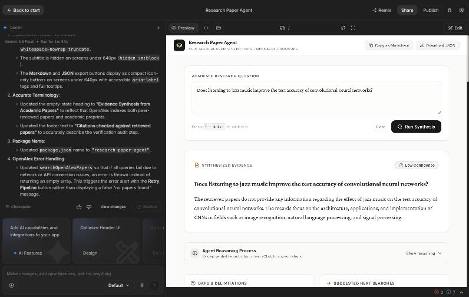

# Research Paper Agent

A web app, built with vibe coding in the Build tab of [Google AI Studio](https://aistudio.google.com/), that answers a research question using real academic papers.

You type a question. The agent searches [OpenAlex](https://openalex.org/), reasons through the papers it finds, and writes an answer that cites them. If the papers don't answer the question, it says so.



## Prompting approach

This assignment asks for a few-shot or chain-of-thought prompt. This agent uses both.

**Chain of thought.** The agent works through six steps and shows each one in the app under "Show reasoning":

1. **Understand:** restate the question and its key concepts.
2. **Screen:** mark each paper relevant or not, with a reason.
3. **Extract:** note the method, data and main finding of each relevant paper.
4. **Compare:** find where the papers agree or disagree.
5. **Check:** make sure each planned claim is backed by a cited paper.
6. **Conclude:** write the answer and rate confidence.

**Few-shot.** The agent gets two worked examples, each with an input and the exact output expected:

| Example | What it teaches |
| --- | --- |
| Why attention replaced fixed-length encodings | A normal answer with citations, including leaving out an irrelevant paper |
| Whether meditation improves language model accuracy | Saying the papers don't answer the question, rather than making something up |

The build prompt also used chain of thought, setting out the app in five ordered steps.

## Assignment files

### Prompts (text and JSON)

| File | Purpose |
| --- | --- |
| [`prompts/build-prompt.txt`](prompts/build-prompt.txt) | The full prompt pasted into AI Studio to build the app |
| [`prompts/follow-up-fixes.txt`](prompts/follow-up-fixes.txt) | The follow-up prompt sent after reviewing the first version |
| [`prompts/agent-system-prompt.txt`](prompts/agent-system-prompt.txt) | The agent's system prompt |
| [`prompts/few-shot-examples.json`](prompts/few-shot-examples.json) | The few-shot examples |
| [`prompts/response-schema.json`](prompts/response-schema.json) | The JSON format the agent must answer in |

### App (exported from AI Studio)

| File | Purpose |
| --- | --- |
| [`metadata.json`](metadata.json) | AI Studio app details |
| [`server.ts`](server.ts) | Gemini calls, which keep the API key on the server |
| [`src/App.tsx`](src/App.tsx) | The main interface and agent flow |
| [`src/services/openAlex.ts`](src/services/openAlex.ts) | Paper search |
| [`src/services/verification.ts`](src/services/verification.ts) | Citation check |

## How it works

1. Gemini turns the question into 2 or 3 keyword searches.
2. The browser searches OpenAlex, removes duplicates and keeps the 10 most relevant papers.
3. Gemini reasons over those papers using the system prompt and few-shot examples, and returns structured JSON.
4. The app's code removes any citation that doesn't match a retrieved paper, and any key finding left with no citations.
5. The app shows the answer, confidence, reasoning, paper cards, gaps and suggested next searches.

## Run it locally

You need Node.js and a [Gemini API key](https://aistudio.google.com/apikey).

```bash
npm install
```

```bash
echo 'GEMINI_API_KEY=your_key_here' > .env.local
```

```bash
npm run dev
```

Then open http://localhost:3000. Never commit your key. `.gitignore` already excludes `.env.local`.

## Testing

| Test | Result |
| --- | --- |
| Question with real evidence (microplastics and gut microbiomes), run in AI Studio | Cited a real paper, which a separate OpenAlex search also found: [Current levels of microplastic pollution impact wild seabird gut microbiomes](https://doi.org/10.1038/s41559-023-02013-z). Medium confidence. |
| Question the papers can't answer (jazz music and neural network accuracy), run in AI Studio | Said the papers don't answer it. Low confidence. |
| Phone layout, run in AI Studio | Header fits on one line after the fix. |
| Made-up citations passed to the citation check | Removed, with a note saying how many. |
| OpenAlex search failing, with a simulated network failure | Raises an error, so the app can show the failure message. |
| `npm run lint` and `npm run build` | Both pass. |

Screenshot of the unanswerable question: [`docs/unanswerable-question.jpg`](docs/unanswerable-question.jpg).

The Retry button and the Gemini failure messages were not tested in the running app.

## Limitations

- The citation check only confirms that a citation points to a retrieved paper. It doesn't prove the paper supports the claim, so check important claims against the source.
- If a citation is removed from the answer text, the sentence around it stays, with no citation.
- The agent reads titles and abstracts, not full papers.
- Results depend on what OpenAlex returns. Its API has a shared free daily allowance when used without a key, so heavy use may fail.

## Changes made after export

The code matches AI Studio's export, apart from these:

- This README replaces the default one.
- `.npmrc` was added, because `npm install` otherwise fails on a dependency conflict in the exported `package.json`.
- `prompts/` and `docs/` were added.
